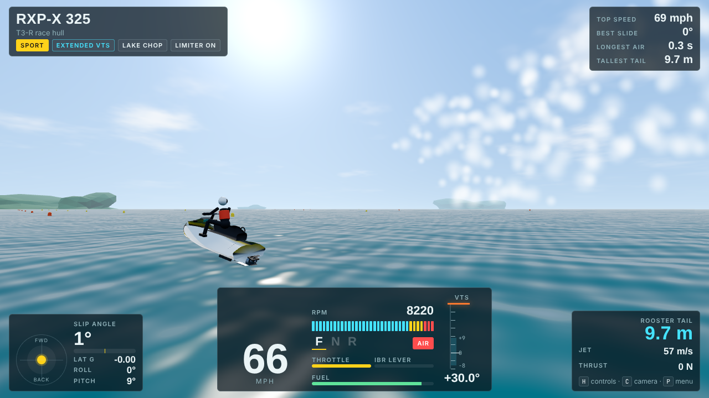

# Rooster Tail

A realistic jet ski (Sea-Doo style) driving simulator that runs in the browser. The physics are built from the research in [RESEARCH.md](RESEARCH.md).



## Run it

It is plain JavaScript modules plus three.js from a CDN, so any static web server works:

```bash
python3 -m http.server 8000
```

Then open http://localhost:8000 and click **Ride**.

To build the single self-contained page (used for the published version):

```bash
node tools/build-artifact.mjs
```

## Controls

| Key | Action |
|---|---|
| W (Shift for half) | Throttle |
| S | iBR lever: brake at speed, reverse when slow |
| A / D | Steer |
| Arrow keys | Body weight: lean left/right, forward/back |
| Space (hold) | Stand up |
| E / Q | VTS trim up / down. Double tap E = full up, double tap Q = neutral |
| T | Trim range: Stock / Extended / Trixx / **MAX TRIM (mod)** |
| M | Riding mode: Sport / Touring / ECO |
| L | Launch control (RXP-X) |
| K | ECU speed limiter on/off |
| C | Camera: chase, far chase, helmet, rooster cam, orbit (drag with mouse) |
| G | Physics overlay (thrust vector, CG, wetted hull points) |
| R / Shift R | Climb back on / reset to start |
| V | Water conditions |
| 1 2 3 | RXP-X 325 / GTI SE 130 / Spark Trixx 90 |

Gamepad: RT throttle, LT iBR, left stick steer, right stick body weight, A stand, RB/LB trim, Y trim range, X camera, B climb back on.

## How the physics work (`src/physics.js`)

- **One rigid body, 6 degrees of freedom.** Mass = hull + fuel + rider. The rider is a mass that moves inside the ski, so leaning really moves the centre of gravity.
- **Hull = about 120 sample points.** Each has a buoyancy prism and a planing pressure `p = 0.5 rho Cp |u| (u.n)` on the bottom normal. Lift grows with speed and trim angle, so the hull climbs over the hump and onto the plane by itself.
- **Side grip** comes from the hull, pump housing and sponsons, modelled as foils that stall at 15 degrees of slip. Past the stall the stern lets go: that is the powerslide.
- **Jet pump:** thrust = k rpm^2 (1 - V/Vjet), applied at the nozzle in the nozzle direction (steering, VTS trim, iBR bucket). The pump only pushes while the intake is in the water. In the air the engine flies to the rev limiter.
- **Engine:** torque curve, pump load ~ rpm^2, rev limiter, idle control, riding modes, launch control, off-throttle assisted steering, ECU speed limiter.
- **Water:** a sum of deep-water sine waves plus expanding wake rings, shared by the physics and the shader. You can jump your own wake.
- **Rider ejection** when sustained g-forces are too high (nose stuff, hook, hard landing) or the ski rolls/flips. The lanyard kills the engine.

`node tools/sim-test.mjs` runs the test bench (acceleration, top speed, turns, braking, trim, reverse) against the real-world numbers. Current RXP-X 325 results: 0-60 mph in about 3.8 s, limited to about 69 mph, iBR stops in about a third of the coasting distance.

## Files

| File | What it does |
|---|---|
| `src/physics.js` | Ski rigid body, hull, pump, engine, iBR, VTS, rider |
| `src/craft.js` | RXP-X 325, GTI SE 130, Spark Trixx 90 specs and trim ranges |
| `src/waves.js` | Ocean waves and wake rings |
| `src/model.js` | Procedural 3D ski and rider (with arm/leg IK) |
| `src/ocean.js` | Water and sky shaders |
| `src/effects.js` | Rooster tail, chine spray, powerslide spray, splashes |
| `src/audio.js` | Synthesised 3-cylinder engine, supercharger whine, water |
| `src/main.js` | Game loop, controls, cameras, HUD |
